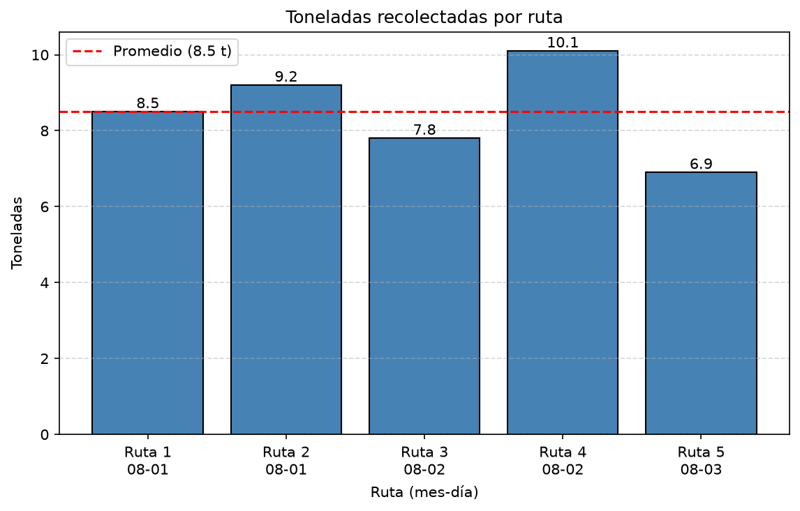
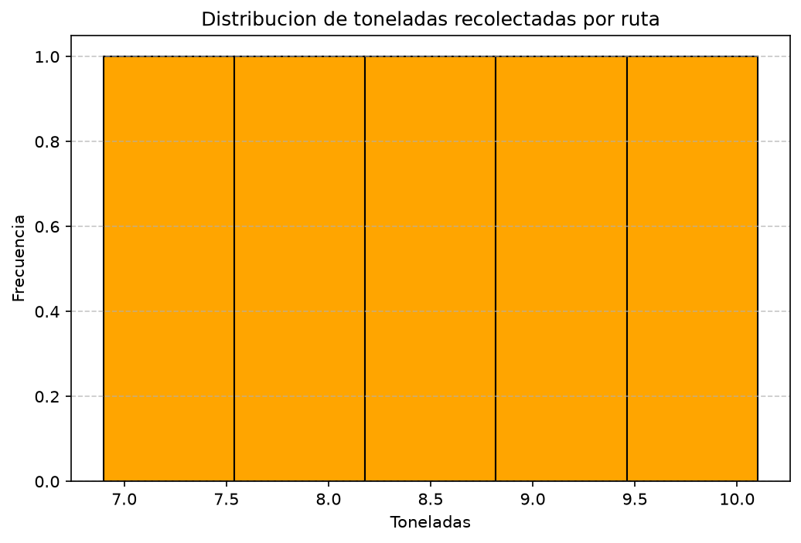
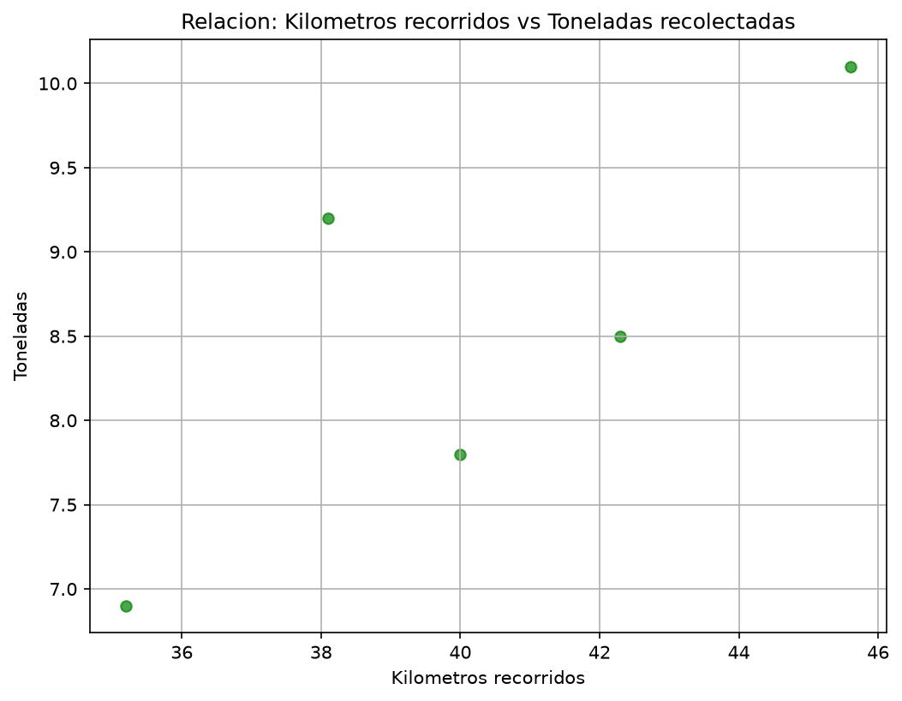

# Sistema inteligente para la planificación y optimización de rutas de recolección y transporte de residuos

Proyecto académico de Inteligencia Artificial (COTECNOVA 2026) — Movilidad y sostenibilidad urbana en **Cartago, Valle del Cauca**.

> **Estado: avance del primer corte.** Carga y procesamiento de datos con Python, análisis exploratorio (EDA) con NumPy y visualización con Matplotlib. El modelo de IA corresponde al siguiente corte.

## 1. Definición del proyecto

### Problemática

Una empresa real de recolección y transporte de residuos sólidos de Cartago planifica sus rutas de forma
empírica, sin anticipar los cambios en la cantidad de residuos generados durante el año ni
optimizar los recorridos cuando cambian las condiciones del servicio. Esto genera ineficiencias
en el uso de recursos, personal, tiempo y combustible.

### Objetivo

Desarrollar un sistema que apoye la toma de decisiones operativas mediante:

1. **Predicción** de la generación de residuos (toneladas por fecha/zona).
2. **Optimización** de rutas de recolección (minimizar distancia y tiempo — VRP).
3. **Predicción** de tiempos de viaje por ruta *(módulo a evaluar según avance del semestre)*.

**Cómo se medirá el éxito:** el modelo de predicción se evaluará con MAE y RMSE sobre datos no vistos
(conjunto de prueba), y la optimización de rutas comparando los kilómetros y el tiempo totales frente
a las rutas actuales de la empresa.

### Datos

- **Fuente:** registros operativos de una empresa real de recolección de residuos de Cartago
  (hora de salida de base, hora de inicio y fin de ruta, toneladas recolectadas, kilómetros recorridos,
  combustible tanqueado, conductor y tripulantes).
- **Estado actual:** se trabaja con un conjunto de **datos ficticios** (`data/rutas_ejemplo.csv`, **5 registros**)
  que replica la estructura real, mientras se integra el histórico completo de la empresa (Excel).
  El código es independiente del tamaño de los datos: al reemplazar el CSV por el histórico real
  con las mismas columnas, todo el análisis se recalcula sin cambios.
- **Por qué estas variables:** cada columna alimenta un módulo del sistema.

| Columna | Tipo | Descripción | Módulo que la usa |
|---|---|---|---|
| `ruta_id` | int | Identificador de la ruta | — |
| `fecha` | texto | Fecha del servicio (AAAA-MM-DD) | Predicción de residuos |
| `conductor` | texto | Conductor asignado | Análisis operativo |
| `tripulantes` | int | Número de tripulantes | Análisis operativo |
| `hora_salida_base` | texto | Hora de salida de la base (HH:MM) | Tiempos de viaje |
| `hora_inicio_ruta` | texto | Hora de inicio de la ruta | Tiempos de viaje |
| `hora_fin_ruta` | texto | Hora de fin de la ruta | Tiempos de viaje |
| `toneladas` | float | Residuos recolectados (t) | Predicción de residuos (variable objetivo) |
| `km_recorridos` | float | Distancia recorrida (km) | Optimización de rutas (VRP) |
| `combustible_tanqueado` | int | Combustible (galones) | Costos / optimización |

## 2. Tecnologías

- Python 3.12
- NumPy, Matplotlib
- Docker, Docker Compose
- Git, GitHub

## 3. Estructura del proyecto

```
Proyecto_ia-python/
├── data/
│   ├── rutas_ejemplo.csv          # datos (ficticios por ahora)
│   ├── toneladas_por_ruta.png     # gráfico de barras
│   ├── distribucion_toneladas.png # histograma
│   └── km_vs_toneladas.png        # dispersión + tendencia
├── src/
│   ├── main.py                    # script principal (ejecuta todo el flujo)
│   ├── config.py                  # rutas del proyecto
│   ├── cargar_datos.py            # CSV -> lista de diccionarios
│   ├── procesamiento.py           # función propia: indicadores por ruta
│   ├── eda_proyecto.py            # EDA con NumPy + gráficos con Matplotlib
│   ├── analisis_proyecto.py       # estadísticas e informe en Markdown
│   └── ejercicios/                # ejercicios de clases anteriores
├── informe_proyecto.md
├── Dockerfile
├── docker-compose.yml
├── requirements.txt
└── README.md
```

## 4. Ejecución

```bash
docker compose build
docker compose up -d
docker compose exec python python src/main.py
```

`main.py` ejecuta el flujo completo: carga → procesamiento → estadísticas → hallazgos → gráficos → informe.
Cada módulo también puede ejecutarse por separado, por ejemplo `docker compose exec python python src/eda_proyecto.py`.

Detener:

```bash
docker compose down
```

## 5. Estructura de datos y funciones

Los datos se cargan con `csv.DictReader` y se convierten en una **lista de diccionarios**, un diccionario por ruta:

```python
{"ruta_id": 1, "fecha": "2026-08-01", "conductor": "Juan Perez", "tripulantes": 2,
 "hora_salida_base": "05:30", "hora_inicio_ruta": "06:00", "hora_fin_ruta": "10:15",
 "toneladas": 8.5, "km_recorridos": 42.3, "combustible_tanqueado": 30}
```

| Módulo | Función | Qué hace |
|---|---|---|
| `cargar_datos.py` | `leer_datos()` | Lee el CSV y devuelve la lista de diccionarios con los números ya convertidos |
| `procesamiento.py` | `calcular_indicadores(fila)` | Agrega a cada ruta: `tiempo_traslado_min`, `duracion_ruta_horas`, `toneladas_por_hora`, `km_por_galon` |
| `procesamiento.py` | `procesar_registros()` | Aplica `calcular_indicadores` a toda la lista (datos procesados) |
| `eda_proyecto.py` | `analizar_datos()` | Media, mediana, desviación estándar, mínimo y máximo con NumPy |
| `eda_proyecto.py` | `identificar_hallazgos()` | Calcula los hallazgos a partir de los datos (correlaciones, grupos) |
| `eda_proyecto.py` | `generar_visualizaciones()` | Genera 3 gráficos con Matplotlib en `data/` |
| `analisis_proyecto.py` | `generar_informe()` | Escribe `informe_proyecto.md` |

## 6. Análisis Exploratorio de Datos (EDA)

Realizado con NumPy y Matplotlib sobre `data/rutas_ejemplo.csv` (`src/eda_proyecto.py`).
No hay valores faltantes en los datos.

### Estadísticas descriptivas

| Variable | Media | Mediana | Desv. estándar | Mínimo | Máximo |
|---|---|---|---|---|---|
| Toneladas recolectadas | 8.50 | 8.50 | 1.10 | 6.90 | 10.10 |
| Kilómetros recorridos | 40.24 | 40.00 | 3.55 | 35.20 | 45.60 |
| Combustible tanqueado (galones) | 28.80 | 29.00 | 2.32 | 25.00 | 32.00 |
| Duración de la ruta (horas) | 4.58 | 4.58 | 0.39 | 4.08 | 5.17 |
| Toneladas por hora | 1.85 | 1.90 | 0.13 | 1.69 | 2.00 |
| Kilómetros por galón | 1.40 | 1.41 | 0.02 | 1.36 | 1.43 |

*(La desviación estándar es poblacional, `np.std` con `ddof=0`.)*

### Hallazgos

1. **La carga recolectada crece con la distancia y, más aún, con la duración de la ruta.**
   Correlación fuerte y positiva de las toneladas con los km recorridos (r = 0.78) y con la
   duración de la ruta (r = 0.88).
2. **Las rutas con 3 tripulantes recolectan más.** Las 2 rutas con 3 tripulantes promedian 9.65 t,
   frente a 7.73 t de las 3 rutas con 2 tripulantes.
3. **El consumo de combustible es muy predecible.** El rendimiento es 1.40 km/galón con una
   variación de solo 1.7 %, y el combustible se correlaciona casi linealmente con los km (r = 0.98).

### Gráficos

| Toneladas por ruta | Distribución de toneladas | Km vs toneladas |
|---|---|---|
|  |  |  |

### Limitaciones

Con solo 5 registros ficticios, los hallazgos son **indicativos, no concluyentes**: una correlación
alta con 5 puntos puede deberse al azar y el histograma tiene pocas barras para mostrar una forma
clara. Se validarán con el histórico real de la empresa.

### Relevancia para el modelo de IA

- La relación toneladas–duración–km indica qué variables usar como predictoras en el modelo de
  **predicción de residuos** y en el de **tiempos de viaje**.
- Si con los datos reales el combustible sigue siendo casi proporcional a los km, en el módulo de
  **optimización (VRP)** minimizar distancia equivaldría a minimizar el costo de combustible.
- El posible efecto de la tripulación sugiere probar `tripulantes` como variable del modelo.

## 7. Próximos pasos (siguiente corte)

- Integrar el histórico real de la empresa y repetir el EDA con más registros.
- Manipular y limpiar los datos con Pandas y explorarlos con Seaborn.
- Entrenar un primer modelo de regresión (Scikit-Learn) para predecir toneladas, con MAE/RMSE como métricas.
- Preparar los datos de distancias entre puntos de recolección para el módulo de optimización de rutas.

## 8. Control de versiones

El código y los datos se versionan en GitHub con commits pequeños y descriptivos (`git log --oneline`).

## 9. Solución de problemas

**Docker no responde:**

```bash
docker --version
```

**`ModuleNotFoundError` al ejecutar:** ejecute el script dentro del contenedor
(`docker compose exec python ...`), donde ya están instaladas las dependencias de `requirements.txt`.

## 10. Equipo

- Saray Foronda
- Damian Correa Tusarma

## 11. Entregables

- [x] Código fuente en GitHub, con commits regulares.
- [x] Documentación (README.md).
- [ ] Presentación final con demo.


## Preparación de Datos

Script: `src/preparacion_datos.py` — dataset: `data/rutas_clase8.csv` (12 rutas, datos ficticios con la estructura real de la empresa).

**Valores nulos:** 2 en `km_recorridos` y 1 en `combustible_tanqueado`. Se imputaron con la mediana de cada columna (63.25 km y 14.0 galones), porque es robusta a valores extremos. `toneladas` (variable objetivo) no se imputa.

**Variables categóricas:** `conductor` se codificó con One-Hot (`pd.get_dummies`), porque es nominal y no tiene orden.

**Columnas derivadas:**
- `duracion_ruta_min`: minutos entre inicio y fin de ruta; resume los tiempos de viaje en un número.
- `toneladas_por_km`: rendimiento de recolección. Se usa para análisis, pero se excluye del modelo porque se calcula con la variable objetivo (data leakage).

**Hallazgos de las visualizaciones:**
- Hay relación positiva entre km recorridos y toneladas recolectadas.
- Andrés Mejía acumula más toneladas (33.5 t) que Carlos Ruiz (30.4 t) y Luis Gómez (24.5 t). Luis siempre sale con 2 tripulantes y los otros con 3, así que el tamaño de la tripulación puede influir.
- Las toneladas por ruta se concentran entre 5.9 y 8.7 t.

**Salida:** `data/rutas_preparadas_ml.csv` (8 columnas, listo para el train/test split).

## Clase 8: Neurona artificial

**`src/neurona_and.py`:** neurona (perceptrón) en Python puro que aprende la compuerta AND ajustando pesos y bias con la regla `w += α·error·x`. Parámetros iniciales w1=0.1, w2=0.1, b=0.0 y tasa de aprendizaje 0.1. Aprendió en **3 épocas**, con error total 3, 3 y 0, y quedó en w1=0.2, w2=0.1, b=-0.2. La curva está en `data/evolucion_error.png`.

**`src/neurona_rutas.py`:** la misma neurona aplicada a las rutas de la empresa (`data/rutas_preparadas_ml.csv`). Dos entradas binarias derivadas de columnas reales:
- `carga_alta`: 1 si las toneladas están en la mediana o por encima.
- `ruta_rapida`: 1 si `duracion_ruta_min` está en la mediana o por debajo.

La etiqueta `alto_desempeno` vale 1 cuando se cumplen ambas condiciones. De las 12 rutas, solo la 1 y la 7 lo cumplen. La neurona aprendió en **3 épocas** (error 4, 4 y 0) y clasificó correctamente las 12.

**Limitación:** la etiqueta se define con una regla AND, así que la neurona redescubre esa regla y no un patrón nuevo. El ejercicio sirve para ver el mecanismo de pesos, error y corrección sobre datos del proyecto. Cuando haya un modelo de predicción real, la variable objetivo será `toneladas`, que es continua.

## Clase 8: Actividad independiente (compuertas OR y NOT)

Script: `src/neuronas_logicas.py`. Gráfica del error: `data/evolucion_error_logicas.png`.

**¿Cuántas épocas necesitó cada compuerta para aprender?** OR aprendió en 2 épocas (error 1 y 0) y NOT en 4 épocas (error 1, 2, 1 y 0). AND, de la actividad en clase, necesitó 3 épocas (error 3, 3 y 0).

**¿Fue necesario ajustar la tasa de aprendizaje? ¿Por qué?** No. Con α = 0.1 las tres compuertas aprendieron sin oscilar y en pocas épocas, así que no hizo falta cambiarla. Con una tasa mucho mayor, cada corrección sería tan grande que los parámetros se pasarían de largo y el error podría oscilar sin converger. Con una muy baja converge igual, pero necesita muchas más épocas.

**¿Qué diferencias hay entre AND y OR?** AND solo da 1 cuando ambas entradas son 1, así que la neurona debe ser "exigente": terminó con un bias negativo (-0.2) y pesos que solo superan el umbral si suman las dos entradas. OR da 1 con que una entrada sea 1, así que basta un umbral bajo: terminó con pesos 0.1 y 0.1 y un bias de solo -0.1, de modo que cualquier entrada activa pasa el umbral. OR aprendió más rápido (2 épocas contra 3) porque los parámetros iniciales ya estaban cerca de la solución, y solo fallaba el caso (0,0). NOT difiere en que tiene una sola entrada y su peso terminó negativo (-0.1), de modo que la entrada 1 resta y apaga la neurona, mientras que con entrada 0 el bias (0.0) alcanza para activarla.

**¿Por qué la compuerta XOR no puede ser aprendida por una sola neurona?** Una neurona con función escalón separa las clases con una única línea recta. En XOR, las salidas 1 están en (0,1) y (1,0), y las salidas 0 en (0,0) y (1,1), es decir, en diagonal. Ninguna recta deja los dos puntos de cada clase del mismo lado, así que XOR no es linealmente separable. Minsky y Papert lo demostraron en 1969 para el perceptrón simple. Se resuelve combinando varias neuronas en capas (una capa oculta), que es la base de las redes neuronales.

## Avance 2

Preparación de datos, visualización y primer modelo (perceptrón desde cero con NumPy). Los datos siguen siendo **ficticios** (12 rutas) con la estructura real de la empresa, mientras se integra el histórico completo.

### Cómo ejecutar con Docker
```bash
docker compose up -d
docker compose exec python bash
python src/preparacion_datos.py      # limpieza, gráficos y datasets en data/
cd src && python perceptron_proyecto.py   # perceptrón, curva y frontera
```

### Preparación de datos (`src/preparacion_datos.py`)
| | Antes | Después |
|---|---|---|
| Filas | 12 | 12 |
| Columnas | 10 | 12 |
| Nulos | 3 | 0 |
| Duplicados | 0 | 0 |

- Nulos en `km_recorridos` (2) y `combustible_tanqueado` (1): imputados con la mediana (63.25 km y 14.0 galones). `toneladas` no se imputa.
- Sin duplicados, sin valores imposibles y sin atípicos (regla 1.5×IQR); los datos se conservan.
- `fecha` convertida a fecha y `conductor` normalizado. `pd.get_dummies` para `conductor`.
- Columnas derivadas: `duracion_ruta_min` y `toneladas_por_km` (esta última se excluye del modelo por data leakage).
- Salidas: `data/proyecto_limpio.csv`, `data/rutas_preparadas_ml.csv` y `data/tabla_antes_despues.csv`.

### Visualización
Tres gráficos con Seaborn en `data/`: distribución de toneladas, toneladas por conductor y km vs toneladas.

### Perceptrón (`src/perceptron_proyecto.py`)
- **Objetivo 0/1:** `1` si `toneladas` supera la mediana (7.65 t). `toneladas` no se usa como entrada.
- **Entradas:** `km_recorridos` y `duracion_ruta_min`, estandarizadas.
- **Modelo:** sigmoide, pérdida logarítmica y descenso del gradiente con NumPy (tasa 0.1, 1000 épocas), sin Scikit-Learn.
- **Resultados:** w1 = 2.971, w2 = 2.110, b = -0.031; pérdida 0.693 → 0.219; exactitud 91.7 %.
- **Gráficos:** `data/curva_aprendizaje_perceptron.png` y `data/frontera_decision_perceptron.png`.
- **Interpretación:** ambos pesos son positivos, así que más km y más duración aumentan la probabilidad de alto tonelaje. Los datos son casi linealmente separables, con un punto mal clasificado cerca de la frontera. Limitaciones: pocos datos, una sola frontera lineal y entradas muy correlacionadas.